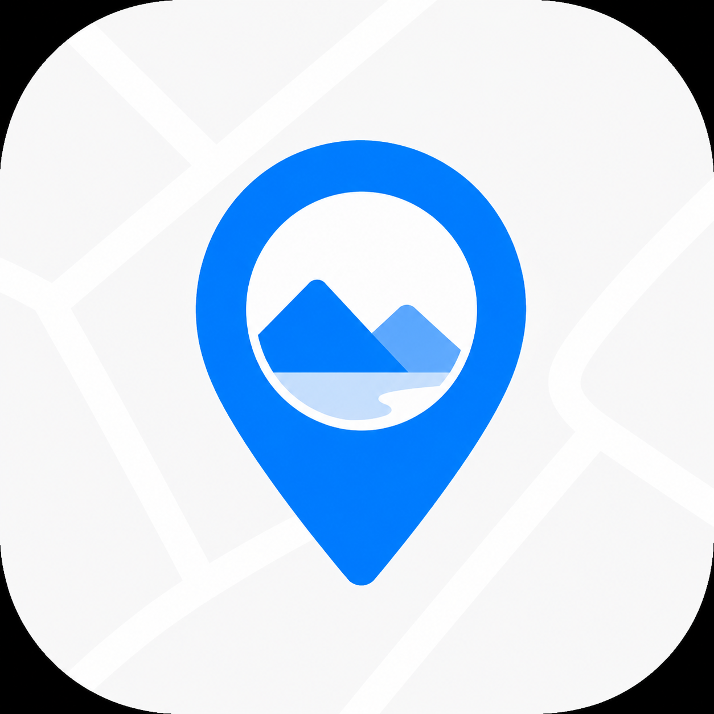
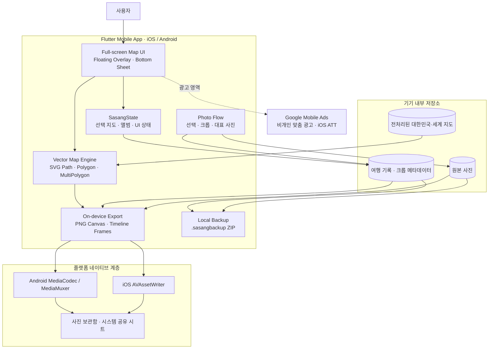

<div align="center">



# 사상 · Sasang

**나의 여행을 사진으로 지도에 남기는 개인 여행 기록 앱**

*대한민국·세계 벡터 지도 · 지역별 사진 앨범 · 여행 타임라인 영상 · 로컬 우선 데이터 보관*

<p align="center">
  
  
  
  
  
  
</p>

<p align="center">
  <a href="https://apps.apple.com/kr/app/%EC%82%AC%EC%83%81/id6806609419"></a>
  <a href="https://play.google.com/store/apps/details?id=com.sasang.app"></a>
</p>

</div>

---

## 1. 서비스 소개

**사상(Sasang)**은 방문한 지역의 행정 경계를 나만의 여행 사진으로 채우는 개인 여행 지도 서비스입니다. 일반적인 길찾기 지도 대신 대한민국 시·군·구와 세계 국가 경계를 벡터 폴리곤으로 표현하고, 사용자가 고른 사진을 해당 지역 모양 안에 자연스럽게 배치합니다.

여행 기록과 원본 사진, 크롭 정보는 앱 전용 기기 저장소에서 처리됩니다. 지도 렌더링과 사진·영상 내보내기도 기기 내부에서 수행하며, 앱 코드에는 여행 기록이나 선택한 사진을 Sasang 서버로 업로드하는 경로가 없습니다.

현재 앱 버전은 **1.1.1 (29)**이며 iOS와 Android에서 동일한 Sasang 디자인과 핵심 기능을 제공합니다.

---

## 2. 주요 기능

### 사진으로 채우는 대한민국·세계 지도

- 대한민국 161개 행정 지역과 세계 175개 국가를 전처리된 SVG Path로 렌더링합니다.
- 방문한 지역을 선택해 사진을 추가하면 행정 경계 내부에 사진이 클리핑됩니다.
- 원본 사진은 변경하지 않고 `scale`, `offsetX`, `offsetY` 크롭 메타데이터를 별도로 저장합니다.
- Polygon과 MultiPolygon을 모두 지원해 섬, 군도, 해외 영토가 있는 지역도 하나의 방문 기록으로 관리합니다.

### 지역별 여행 앨범

- 한 지역에 여러 장의 사진을 보관할 수 있습니다.
- 지도에 표시할 대표 사진을 선택하고 개별 사진을 추가하거나 정리할 수 있습니다.
- 촬영일과 등록일을 기반으로 여행 기록을 시간순으로 확인합니다.

### 사진·영상 내보내기

- 사진: **1080 × 1920 PNG**
- 영상: **720 × 1280, 12 fps, H.264 MP4**
- 영상에는 곡선 점선 항로, 작은 2D 비행기 이동, 도착 펄스와 지역별 사진 전환이 포함됩니다.
- 국제 날짜 변경선과 해외 영토를 고려해 항로가 현재 지도 프레임 안에서 자연스럽게 이동합니다.
- 완료된 결과는 사진 보관함에 저장하거나 시스템 공유 시트로 전달할 수 있습니다.

### 로컬 백업 파일

- 여행 기록, 프로필 정보, 원본 사진을 하나의 `.sasangbackup` 파일로 묶어 내보냅니다.
- 생성된 파일은 AirDrop, 클라우드 드라이브, 메신저 등 사용자가 선택한 앱으로 옮길 수 있습니다.
- 현재 백업 파일은 암호화되지 않으므로 사용자가 신뢰하는 위치에 보관해야 합니다.

### 지도 라이브러리와 지도 상점

- 보유한 지도를 2열 그리드에서 확인하고 현재 사용할 지도를 전환합니다.
- 지도 수가 늘어나면 목록 영역만 스크롤되며 헤더와 지도 상점 진입 액션은 고정됩니다.
- 지도 상점에서는 국가명 검색과 실제 SVG 미리보기를 지원합니다.

---

## 3. 서비스 화면

<div align="center">
  
  
  
</div>

태블릿 화면과 Android 스토어용 이미지는 [`assets/store-img/`](./assets/store-img/)에서 확인할 수 있습니다.

---

## 4. 아키텍처



핵심 지도 파이프라인은 다음과 같습니다.

```text
행정 경계 원본(SHP / GeoJSON)
        ↓ 빌드 타임 전처리
좌표 정규화 · 단순화 · MultiPolygon 보존
        ↓
경량 SVG Path JSON
        ↓ Flutter Canvas
사진 클리핑 · 선택 · 내보내기
```

대용량 원본 GeoJSON은 앱 실행 중 파싱하지 않습니다. `scripts/map-data/`에서 결정론적으로 전처리한 경량 자산만 앱에 포함합니다. 저장소의 `backend/`와 `packages/shared/`는 향후 동기화용 API 기반이지만, 현재 배포 앱의 여행 기록과 사진 저장 흐름에는 연결되어 있지 않습니다.

---

## 5. 기술 스택

| 영역 | 기술 | 역할 |
| :--- | :--- | :--- |
| Mobile | Flutter 3.35.3, Dart 3.9.2 | iOS·Android 공통 애플리케이션과 UI |
| Map Rendering | Flutter Canvas, SVG Path, `path_drawing` | 행정 경계 렌더링과 사진 폴리곤 클리핑 |
| Image | `image_picker`, EXIF, Flutter image codec | 사진 선택, 촬영일 판독, 로컬 이미지 처리 |
| Video | Android MediaCodec/MediaMuxer, iOS AVAssetWriter | H.264 여행 타임라인 영상 인코딩 |
| Persistence | 앱 문서 디렉터리, JSON metadata | 여행 기록·앨범·크롭 정보의 로컬 저장 |
| Backup & Share | `archive`, `share_plus`, `gal` | 단일 백업 파일, 시스템 공유, 사진 보관함 저장 |
| Ads & Privacy | Google Mobile Ads, iOS ATT | 광고 표시와 iOS 추적 권한 처리 |
| Map Pipeline | Node.js, `polygon-clipping` | SHP/GeoJSON 정규화와 모바일 지도 자산 생성 |
| Backend Foundation | Next.js 16, Prisma, PostgreSQL, Zod | 버전형 API와 공유 계약을 위한 독립 기반 |
| Test | `flutter_test`, Integration Test, Vitest, Node Test | UI·지도·내보내기·데이터 호환성 검증 |

---

## 6. 개인정보와 데이터 처리

Sasang의 핵심 원칙은 **여행 기록의 로컬 우선 처리**입니다.

- 선택한 여행 사진과 지역별 기록은 앱 전용 기기 저장소에 보관됩니다.
- 사진 배치 정보는 원본을 영구 편집하지 않고 별도의 크롭 메타데이터로 저장됩니다.
- 사진·영상 생성과 백업 압축은 기기 내부에서 처리됩니다.
- 내보낸 파일은 사용자가 시스템 공유 시트에서 선택한 대상에만 전달됩니다.
- 앱 삭제, 기기 초기화 또는 앱 내 데이터 삭제 시 로컬 데이터가 사라질 수 있으므로 중요한 기록은 백업해야 합니다.
- Google Mobile Ads SDK는 광고 요청 과정에서 모바일 식별자 또는 네트워크 정보를 처리할 수 있습니다. iOS에서는 광고 SDK 초기화 전에 App Tracking Transparency 권한 절차를 수행합니다.

앱 내 최신 안내는 **더보기 → 개인정보**에서 확인할 수 있습니다. 법적 정책과 App Store Connect·Google Play의 데이터 공개 정보는 실제 배포 설정과 함께 유지해야 합니다.

---

## 7. 저장소 구조

```text
sasang/
├─ lib/                         # Flutter 애플리케이션
│  ├─ core/                    # 테마, 저장소, 광고, 공통 레이아웃
│  ├─ features/
│  │  ├─ map/                 # 지도 로딩, 렌더링, 지도 선택
│  │  ├─ photos/              # 사진 선택, 앨범, 크롭 흐름
│  │  ├─ share/               # PNG/MP4 생성과 진행 상태
│  │  ├─ backup/              # .sasangbackup 생성
│  │  └─ state/               # 앱 상태와 로컬 영속화 연결
│  ├─ screens/                 # 지도, 장소, 더보기, 정보, 지도 상점
│  └─ widgets/                 # 공통 Sasang UI 컴포넌트
├─ android/                     # Android 호스트와 MediaCodec 구현
├─ ios/                         # iOS 호스트와 AVAssetWriter 구현
├─ assets/
│  ├─ maps/korea/              # 대한민국 행정 경계 자산
│  ├─ maps/world/              # 세계 국가 경계 자산
│  └─ store-img/               # App Store·Google Play 소개 이미지
├─ integration_test/            # 네이티브 영상 인코딩 통합 테스트
├─ test/                        # 단위·위젯·골든 테스트
├─ scripts/map-data/            # 지도 데이터 전처리와 검증
├─ backend/                     # 독립 실행 가능한 Next.js API 기반
├─ packages/shared/             # 공유 Zod 스키마와 DTO
└─ docs/                        # 아키텍처·마이그레이션·내보내기 문서
```

---

## 8. 개발 환경 구성

### 요구 사항

- Flutter **3.35.3** stable 또는 호환되는 최신 stable
- Dart **3.9.2+**
- Android Studio 및 Android SDK
- iOS 빌드 시 macOS, Xcode, CocoaPods
- 지도 데이터 또는 백엔드 작업 시 Node.js **22.13+**, pnpm **10.34.5**

### 앱 실행

```bash
git clone https://github.com/minwoo1119/SaSang.git
cd SaSang

flutter pub get
flutter run
```

연결할 API가 있는 개발 환경에서는 빌드 타임 값을 지정할 수 있습니다.

```bash
flutter run --dart-define=API_URL=http://localhost:3000
```

현재 핵심 여행 기록 기능은 이 API 없이 로컬에서 동작합니다.

### 품질 검사

```bash
flutter analyze
flutter test
```

네이티브 H.264 인코딩 검증은 실제 플랫폼 대상에서 실행합니다.

```bash
flutter test integration_test/map_share_integration_test.dart -d <device-id>
```

### 지도 데이터 재생성

```bash
corepack enable
pnpm install
pnpm map:generate
pnpm map:test
```

지도 생성기는 동일한 원본과 옵션에 대해 같은 결과를 출력하며, 생성된 지도 파일은 직접 수정하지 않습니다. 데이터 출처와 전처리 기준은 [`scripts/map-data/README.md`](./scripts/map-data/README.md) 및 [`scripts/map-data/NOTICE.md`](./scripts/map-data/NOTICE.md)를 참고하세요.

---

## 9. 빌드와 배포

```bash
# Android App Bundle
flutter build appbundle --release

# iOS archive 사전 검증
flutter build ios --release --no-codesign
```

배포 전에는 다음 항목을 반드시 확인합니다.

1. `pubspec.yaml`의 버전과 빌드 번호 증가
2. Android 프로덕션 keystore와 iOS 배포 인증서·프로비저닝 프로필 연결
3. 실제 기기에서 사진 선택, 보관함 저장, H.264 영상 생성과 시스템 공유 확인
4. iOS ATT 요청 및 광고 초기화 순서 확인
5. App Store Connect와 Google Play Console의 개인정보·데이터 수집 공개 정보 확인
6. 대한민국·세계 지도 내보내기 결과와 MultiPolygon 지역 회귀 확인

---

## 10. 프로젝트 문서

- [`docs/architecture.md`](./docs/architecture.md): 모바일·백엔드·지도 전처리 책임 분리
- [`docs/map-sharing.md`](./docs/map-sharing.md): PNG/MP4 규격과 네이티브 인코딩 흐름
- [`docs/photo-albums.md`](./docs/photo-albums.md): 지역별 다중 사진과 기존 데이터 호환 정책
- [`docs/flutter-migration-validation.md`](./docs/flutter-migration-validation.md): Flutter 마이그레이션 검증 기준
- [`docs/export-improvements-review.md`](./docs/export-improvements-review.md): 영상 내보내기 개선 검토 결과
- [`AGENTS.md`](./AGENTS.md): 저장소 아키텍처, 네이밍, 테스트 및 작업 규칙

---

## 11. 개발 원칙

- **사진 중심**: 지도는 구성 레이어이며 사용자의 여행 사진이 핵심 콘텐츠입니다.
- **로컬 우선**: 여행 기록과 사진은 명시적인 사용자 동작 없이 외부로 전송하지 않습니다.
- **벡터 지도**: 지역마다 PNG를 만들지 않고 안정적인 코드가 있는 Polygon/MultiPolygon을 사용합니다.
- **원본 보존**: 사진을 영구 재단하지 않고 변환 메타데이터를 저장합니다.
- **플랫폼 일관성**: iOS와 Android에서 동일한 Sasang 디자인과 기능 흐름을 제공합니다.
- **결정론적 지도 생성**: 행정 경계 변경은 생성 스크립트와 데이터 버전으로 관리합니다.
- **회귀 방지**: 지도 선택, 사진 변환, 데이터 호환성, 내보내기와 네이티브 인코딩을 자동 테스트합니다.

---

## 12. 배포 링크

- **iOS / iPadOS:** [App Store에서 사상 다운로드](https://apps.apple.com/kr/app/%EC%82%AC%EC%83%81/id6806609419)
- **Android:** [Google Play에서 사상 다운로드](https://play.google.com/store/apps/details?id=com.sasang.app)
- **소스 저장소:** [github.com/minwoo1119/SaSang](https://github.com/minwoo1119/SaSang)

버그 제보나 개선 제안은 GitHub Issues 또는 각 스토어의 공식 지원 채널을 이용해 주세요.
