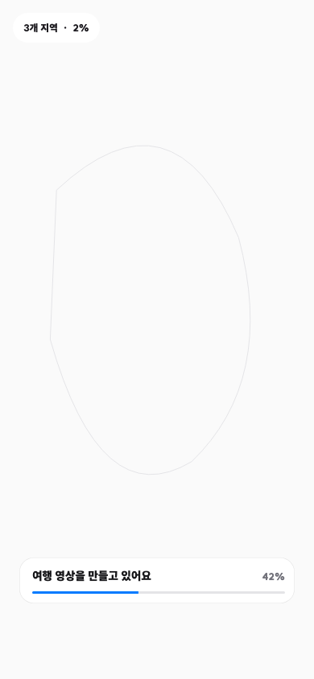
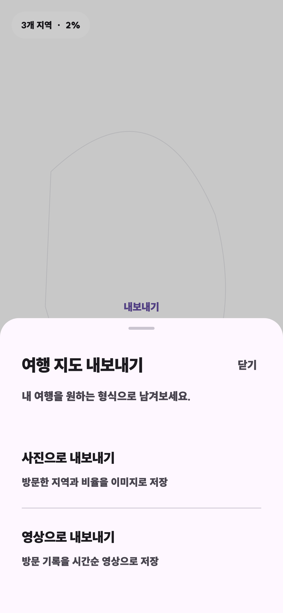

# 여행 영상 내보내기 개선 검토

## 구현 결과

- Full-screen 지도와 Floating Overlay 구조를 유지했다.
- 사진/영상 형식 선택과 `내보내기 완료` 저장/공유 선택은 iOS·Android 공통으로 기존 사상 전용 Bottom Sheet를 복원했다. 원형 아이콘, 보조 설명, 화살표와 기존 여백을 포함한다.
- 중앙 차단 모달을 제거하고 지도 하단에 렌더링 진행률, 인코딩 상태, 중단·재시도 동작을 표시한다.
- 영상 경로를 직선에서 곡선 점선으로 바꾸고 작은 2D 비행기와 도착 펄스를 추가했다.
- 세계 지도는 GPS → 생성된 대표 본토 앵커 → 런타임 최대 컴포넌트 순으로 위치를 결정한다.
- 날짜변경선을 넘는 항로는 화면 밖으로 래핑하지 않고 현재 지도 프레임 안의 단일 곡선으로 연결해, 점선·비행기·카메라가 같은 방향으로 이동한다.
- 사진 EXIF의 촬영일과 GPS를 기기에서 읽고, 원본 사진·여행 기록·렌더링 프레임·MP4를 모두 기기 내부에서 처리한다.

## UI 비교

| 기준/이전 | 현재 |
| --- | --- |
| 중앙을 가리고 조작을 막는 진행 모달  | 지도 하단 Floating Progress  |
| 기존 공유 모달 디자인 레퍼런스  | 아이콘·보조 설명·화살표를 갖춘 사상 커스텀 Bottom Sheet 복원  |

## 영상 검토 산출물

- [개선된 국내 여행 영상](../artifacts/sasang-export-review/domestic_after.mp4)
- [개선된 세계 여행 영상](../artifacts/sasang-export-review/world_after.mp4)
- [국내 영상 대표 프레임](../artifacts/sasang-export-review/frames/domestic_after-5.png)
- [세계 영상 대표 프레임](../artifacts/sasang-export-review/frames/world_after-5.png)

두 영상은 iPhone 17 Pro 시뮬레이터의 실제 네이티브 인코더로 생성했다.

| 항목 | 결과 |
| --- | --- |
| 컨테이너 / 코덱 | MP4 / H.264 (`avc1`) |
| 해상도 | 720 × 1280 (9:16) |
| 프레임률 | 30fps |
| 길이 | 국내 7초 / 세계 7초 |
| 국내 시나리오 | 서울 → 부산 → 제주 |
| 세계 시나리오 | 일본 → 미국 → 프랑스 |

## 검증 결과

- `flutter analyze`: 통과, 0 issues
- `flutter test`: 45 tests 통과
- `pnpm map:test`: 5 tests 통과
- iOS 영상 통합 테스트: 통과
- iOS release `--no-codesign`: 통과
- Android release App Bundle: 통과

회귀 테스트는 프랑스 본토 대표 앵커, 사진 GPS 우선순위, 캐나다→러시아 화면 내 우측 이동, 일본→미국 화면 내 연결, 국내 곡선 경로 결정성, 하단 진행 UI, 인코딩 단계의 가짜 퍼센트 미표시, iOS·Android 공통 원본 형식 선택 UI, 대한민국/세계 지도 전환, 새로운 지도 상점 이동을 포함한다.
